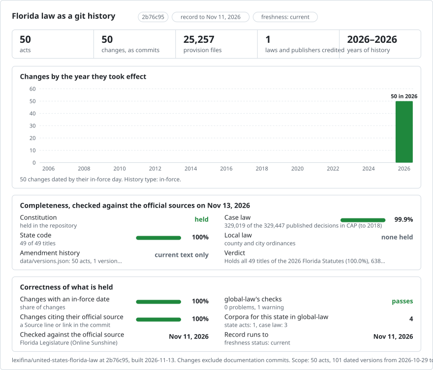

# Florida: law history in git

<picture>
<source media="(prefers-color-scheme: dark)" srcset="data/effort-dark.svg">

</picture>

Part of [lexifina/global-law](https://github.com/lexifina/global-law), one git history for every country's law: this is the law of Florida, United States, which global-law reads at `united-states/florida/acts/`.

The statute law of Florida as a git repository: one file per section, committed with the official publisher named as author. It follows the shared design of [lexifina/global-law](https://github.com/lexifina/global-law).

**What is in it now (current text and annual editions, incomplete history)**

| Folder | Act | Versions | History |
| --- | --- | ---: | --- |
| `constitution/` | Constitution of the State of Florida (214 sections) | 1 | One version: the text as the Florida Legislature publishes it in the 2026 Florida Statutes, captured 30 October 2026 (dated 29 October); the source gives no in-force day for it |
| `title-36-business-organizations/` | Florida Statutes, Title XXXVI: Business Organizations (970 sections) | 2 | Official 2025 annual-edition snapshot and published 2026 text; exact commencement dates are not asserted |
| `title-40-real-and-personal-property/` | Florida Statutes, Title XL: Real and Personal Property (798 sections) | 2 | Official 2025 annual-edition snapshot and published 2026 text; exact commencement dates are not asserted |
| `title-46-crimes/` | Florida Statutes, Title XLVI: Crimes (985 sections) | 2 | Official 2025 annual-edition snapshot and published 2026 text; exact commencement dates are not asserted |
| `title-1-construction-of-statutes/` | Florida Statutes, Title I: Construction of Statutes (8 sections) | 2 | Official 2025 annual-edition snapshot and published 2026 text; exact commencement dates are not asserted |
| `title-2-state-organization/` | Florida Statutes, Title II: State Organization (93 sections) | 2 | Official 2025 annual-edition snapshot and published 2026 text; exact commencement dates are not asserted |
| `title-3-legislative-branch-commissions/` | Florida Statutes, Title III: Legislative Branch; Commissions (76 sections) | 2 | Official 2025 annual-edition snapshot and published 2026 text; exact commencement dates are not asserted |
| `title-4-executive-branch/` | Florida Statutes, Title IV: Executive Branch (294 sections) | 2 | Official 2025 annual-edition snapshot and published 2026 text; exact commencement dates are not asserted |
| `title-5-judicial-branch/` | Florida Statutes, Title V: Judicial Branch (458 sections) | 2 | Official 2025 annual-edition snapshot and published 2026 text; exact commencement dates are not asserted |
| `title-6-civil-practice-and-procedure/` | Florida Statutes, Title VI: Civil Practice and Procedure (798 sections) | 2 | Official 2025 annual-edition snapshot and published 2026 text; exact commencement dates are not asserted |
| `title-7-evidence/` | Florida Statutes, Title VII: Evidence (139 sections) | 2 | Official 2025 annual-edition snapshot and published 2026 text; exact commencement dates are not asserted |
| `title-8-limitations/` | Florida Statutes, Title VIII: Limitations (24 sections) | 2 | Official 2025 annual-edition snapshot and published 2026 text; exact commencement dates are not asserted |
| `title-9-electors-and-elections/` | Florida Statutes, Title IX: Electors and Elections (363 sections) | 2 | Official 2025 annual-edition snapshot and published 2026 text; exact commencement dates are not asserted |
| `title-10-public-officers-employees-and-records/` | Florida Statutes, Title X: Public Officers, Employees, and Records (495 sections) | 2 | Official 2025 annual-edition snapshot and published 2026 text; exact commencement dates are not asserted |
| `title-11-county-organization-and-intergovernmental-relations/` | Florida Statutes, Title XI: County Organization and Intergovernmental Relations (813 sections) | 2 | Official 2025 annual-edition snapshot and published 2026 text; exact commencement dates are not asserted |
| `title-12-municipalities/` | Florida Statutes, Title XII: Municipalities (292 sections) | 2 | Official 2025 annual-edition snapshot and published 2026 text; exact commencement dates are not asserted |
| `title-13-planning-and-development/` | Florida Statutes, Title XIII: Planning and Development (134 sections) | 2 | Official 2025 annual-edition snapshot and published 2026 text; exact commencement dates are not asserted |
| `title-14-taxation-and-finance/` | Florida Statutes, Title XIV: Taxation and Finance (1176 sections) | 2 | Official 2025 annual-edition snapshot and published 2026 text; exact commencement dates are not asserted |
| `title-15-homestead-and-exemptions/` | Florida Statutes, Title XV: Homestead and Exemptions (25 sections) | 2 | Official 2025 annual-edition snapshot and published 2026 text; exact commencement dates are not asserted |
| `title-16-teachers-retirement-system-higher-educational-facilities-bonds/` | Florida Statutes, Title XVI: Teachers' Retirement System; Higher Educational Facilities Bonds (81 sections) | 2 | Official 2025 annual-edition snapshot and published 2026 text; exact commencement dates are not asserted |
| `title-17-military-affairs-and-related-matters/` | Florida Statutes, Title XVII: Military Affairs and Related Matters (171 sections) | 2 | Official 2025 annual-edition snapshot and published 2026 text; exact commencement dates are not asserted |
| `title-18-public-lands-and-property/` | Florida Statutes, Title XVIII: Public Lands and Property (480 sections) | 2 | Official 2025 annual-edition snapshot and published 2026 text; exact commencement dates are not asserted |
| `title-19-public-business/` | Florida Statutes, Title XIX: Public Business (417 sections) | 2 | Official 2025 annual-edition snapshot and published 2026 text; exact commencement dates are not asserted |
| `title-20-veterans/` | Florida Statutes, Title XX: Veterans (81 sections) | 2 | Official 2025 annual-edition snapshot and published 2026 text; exact commencement dates are not asserted |
| `title-21-drainage/` | Florida Statutes, Title XXI: Drainage (58 sections) | 2 | Official 2025 annual-edition snapshot and published 2026 text; exact commencement dates are not asserted |
| `title-22-ports-and-harbors/` | Florida Statutes, Title XXII: Ports and Harbors (90 sections) | 2 | Official 2025 annual-edition snapshot and published 2026 text; exact commencement dates are not asserted |
| `title-23-motor-vehicles/` | Florida Statutes, Title XXIII: Motor Vehicles (712 sections) | 2 | Official 2025 annual-edition snapshot and published 2026 text; exact commencement dates are not asserted |
| `title-24-vessels/` | Florida Statutes, Title XXIV: Vessels (131 sections) | 2 | Official 2025 annual-edition snapshot and published 2026 text; exact commencement dates are not asserted |
| `title-25-aviation/` | Florida Statutes, Title XXV: Aviation (120 sections) | 2 | Official 2025 annual-edition snapshot and published 2026 text; exact commencement dates are not asserted |
| `title-26-public-transportation/` | Florida Statutes, Title XXVI: Public Transportation (392 sections) | 2 | Official 2025 annual-edition snapshot and published 2026 text; exact commencement dates are not asserted |
| `title-27-railroads-and-other-regulated-utilities/` | Florida Statutes, Title XXVII: Railroads and Other Regulated Utilities (196 sections) | 2 | Official 2025 annual-edition snapshot and published 2026 text; exact commencement dates are not asserted |
| `title-28-natural-resources-conservation-reclamation-and-use/` | Florida Statutes, Title XXVIII: Natural Resources; Conservation, Reclamation, and Use (738 sections) | 2 | Official 2025 annual-edition snapshot and published 2026 text; exact commencement dates are not asserted |
| `title-29-public-health/` | Florida Statutes, Title XXIX: Public Health (1503 sections) | 2 | Official 2025 annual-edition snapshot and published 2026 text; exact commencement dates are not asserted |
| `title-30-social-welfare/` | Florida Statutes, Title XXX: Social Welfare (723 sections) | 2 | Official 2025 annual-edition snapshot and published 2026 text; exact commencement dates are not asserted |
| `title-31-labor/` | Florida Statutes, Title XXXI: Labor (323 sections) | 2 | Official 2025 annual-edition snapshot and published 2026 text; exact commencement dates are not asserted |
| `title-32-regulation-of-professions-and-occupations/` | Florida Statutes, Title XXXII: Regulation of Professions and Occupations (1524 sections) | 2 | Official 2025 annual-edition snapshot and published 2026 text; exact commencement dates are not asserted |
| `title-33-regulation-of-trade-commerce-investments-and-solicitations/` | Florida Statutes, Title XXXIII: Regulation of Trade, Commerce, Investments,   and Solicitations (1668 sections) | 2 | Official 2025 annual-edition snapshot and published 2026 text; exact commencement dates are not asserted |
| `title-34-alcoholic-beverages-and-tobacco/` | Florida Statutes, Title XXXIV: Alcoholic Beverages and Tobacco (233 sections) | 2 | Official 2025 annual-edition snapshot and published 2026 text; exact commencement dates are not asserted |
| `title-35-agriculture-horticulture-and-animal-industry/` | Florida Statutes, Title XXXV: Agriculture, Horticulture, and Animal Industry (611 sections) | 2 | Official 2025 annual-edition snapshot and published 2026 text; exact commencement dates are not asserted |
| `title-37-insurance/` | Florida Statutes, Title XXXVII: Insurance (2278 sections) | 2 | Official 2025 annual-edition snapshot and published 2026 text; exact commencement dates are not asserted |
| `title-38-banks-and-banking/` | Florida Statutes, Title XXXVIII: Banks and Banking (348 sections) | 2 | Official 2025 annual-edition snapshot and published 2026 text; exact commencement dates are not asserted |
| `title-39-commercial-relations/` | Florida Statutes, Title XXXIX: Commercial Relations (893 sections) | 2 | Official 2025 annual-edition snapshot and published 2026 text; exact commencement dates are not asserted |
| `title-41-statute-of-frauds-fraudulent-transfers-and-general-assignments/` | Florida Statutes, Title XLI: Statute of Frauds, Fraudulent Transfers, and General Assignments (37 sections) | 2 | Official 2025 annual-edition snapshot and published 2026 text; exact commencement dates are not asserted |
| `title-42-estates-and-trusts/` | Florida Statutes, Title XLII: Estates and Trusts (470 sections) | 2 | Official 2025 annual-edition snapshot and published 2026 text; exact commencement dates are not asserted |
| `title-43-domestic-relations/` | Florida Statutes, Title XLIII: Domestic Relations (265 sections) | 2 | Official 2025 annual-edition snapshot and published 2026 text; exact commencement dates are not asserted |
| `title-44-civil-rights/` | Florida Statutes, Title XLIV: Civil Rights (95 sections) | 2 | Official 2025 annual-edition snapshot and published 2026 text; exact commencement dates are not asserted |
| `title-45-torts/` | Florida Statutes, Title XLV: Torts (198 sections) | 2 | Official 2025 annual-edition snapshot and published 2026 text; exact commencement dates are not asserted |
| `title-47-criminal-procedure-and-corrections/` | Florida Statutes, Title XLVII: Criminal Procedure and Corrections (1219 sections) | 2 | Official 2025 annual-edition snapshot and published 2026 text; exact commencement dates are not asserted |
| `title-48-early-learning-20-education-code/` | Florida Statutes, Title XLVIII: Early Learning-20 Education Code (985 sections) | 2 | Official 2025 annual-edition snapshot and published 2026 text; exact commencement dates are not asserted |
| `title-49-parents-bill-of-rights-teachers-bill-of-rights/` | Florida Statutes, Title XLIX: Parents' Bill of Rights; Teachers' Bill of Rights (12 sections) | 2 | Official 2025 annual-edition snapshot and published 2026 text; exact commencement dates are not asserted |

Nothing else of Florida's law is in it yet.

## Where the text comes from

The text is read from **Online Sunshine**, <https://www.leg.state.fl.us/statutes/>, where the **Florida Legislature** publishes the Constitution and the 2026 Florida Statutes. Each chapter comes from the site's "View Entire Chapter" page and the Constitution from one page. Each section keeps its catchline, its text with subsection, paragraph and subparagraph designators in the order the page gives them, its History line (the session laws behind it) and any Note the Legislature prints inside the section, with the page's own punctuation (curly quotes and dashes) and a word break wherever the page breaks a line. Footnote markers are retained as the official text prints them. The two normative symbols in sections 320.0842 and 322.051 are linked in place as byte-exact official GIF assets.

## Dates

- The current snapshot is the text as the pages showed it when captured: the Constitution and Titles XXXVI, XL and XLVI were captured on 30 October 2026 and are dated 29 October, the day before; the other titles were captured and are dated on 3 November 2026. The site prints no in-force day for the edition or a title, so these are capture days (`Text-as-of`), not days the text took effect; the correction commits say so (`In-force-basis`). Dates some sections state for themselves (such as Art. XII s. 42 of the Constitution) are part of their text. The 2025 annual edition is also included for 49 titles; earlier annual editions remain incomplete.
- The first commit of each act is credited to the Florida Legislature as "oldest version available".
- The session laws in each History line are part of the text, not the commit dates.
- The correction commits restore the page's own text: its punctuation (an earlier build had made curly quotes and dashes ASCII), the word breaks at line breaks, and text that follows a list back after it. They are appended; the earlier commits are unchanged.

## What it does not show

- Exact section-level amendment dates and complete earlier annual editions.
- The Laws of Florida (session laws) and regulations.
- Nothing here is an official publication.

## How it is checked

- Every unit is read back from git on its day and compared with the corpus (`tools/check_repo.py`; results in `REPRODUCE.md`).
- Each source file is identified by its sha256, in `data/versions.json`.

## What "author" means

Each act's original commit is authored by the publisher (the Florida Legislature (Online Sunshine)) for the original current snapshots. The annual-edition backfills are labelled correction commits authored by Lexifina. The correction commits that restore the page's own text and label the dates are authored by Lexifina. The committer is always Lexifina.

## Current text corrections

593 sections across 39 titles have labelled corrections restoring the official word boundaries at superscript markers, mixed numbers and block breaks. These corrections retain the existing version dates and make no new commencement assertion. Earlier annual editions remain incomplete.

Four Constitution sections also have a labelled correction restoring six word joins at the publisher's inline note markers. The correction retains the existing 29 October 2026 capture boundary and makes no new commencement assertion.

## Section history citations

The official 2026 Florida Statutes History annotations are indexed by section in `data/section-history/`: 24,993 sections across 49 titles, 24,993 History annotations and 148,384 citation items in source order. The index preserves the publisher's words and links each entry to its official chapter page. Citation items include earlier statutory compilations and session laws; their roles and effective dates are not inferred. Sections without a History annotation have an empty list. The Constitution is outside this statutory index.

## Official current-text source surveys

50 acts covering 25,206 sections and the preamble have source surveys in `data/source-surveys/2026/`. Each identifies its official source pages and independently verified section coverage, with a source image inventory. These surveys cover the current published text, including the two normative Title XXIII symbols restored in a labelled correction. They do not establish section commencement dates or verify earlier annual editions. Earlier legal files and their history are preserved.

## Official 2025 annual editions

The record also includes 49 title snapshots containing 24,866 sections from the official 2025 Florida Statutes. They are labelled backfilled correction commits, with the published current text retained at the tip. The source labels the edition by year without an exact edition day. The 31 December 2025 history boundary is an annual-edition convention, not a claim that its sections took effect together. The per-title inventory and correction commits are listed in `data/annual-editions/2025.json`. Exact commencement dates and complete older editions remain outside this record.
