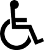

# 320.0842. Free motor vehicle license plates to veterans who use wheelchairs.
(1) Upon application by any person who owns or leases a motor vehicle and who is qualified under subsection (2), the department shall issue to such person a free motor vehicle license plate, similar in all respects to the plate issued under s. 320.084, with the exception that the designation “DV” is replaced by the international symbol of accessibility. The international symbol of accessibility is as follows:

(2) In order to be eligible for the motor vehicle license plate described in subsection (1), a person must comply with the following provisions:
(a) The veteran must be eligible for the license plate issued under s. 320.084 and must apply for the license plate issued under this section in lieu of or in exchange for the motor vehicle license number plate authorized by s. 320.084; and
(b) The veteran must offer, in addition to the proof required by s. 320.084(1), proof that due to a service-connected disability he or she permanently uses a wheelchair or proof, in the form of an application that conforms to the requirements set forth in s. 320.0848, that he or she qualifies for a disabled parking permit under that section. The license plate entitles the person to all privileges afforded by a parking permit issued under s. 320.0848.
(3) Upon request, the department shall issue, to a person who has received a motor vehicle license plate under subsection (2), a designation plate containing only the international symbol of accessibility, to be displayed on the front of a vehicle.
(4) Section 320.084(3) and (4) applies to license plates issued under this section.
History.—s. 1, ch. 72-31; s. 2, ch. 74-202; s. 5, ch. 79-82; s. 2, ch. 79-208; s. 30, ch. 83-318; s. 355, ch. 95-148; s. 11, ch. 96-200; s. 5, ch. 98-202.
